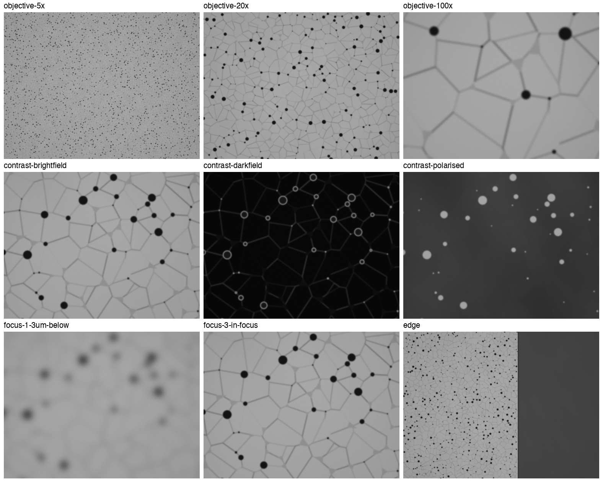

# scopepilot

Microscope vendor software is dense and hard to navigate: people at the
instrument lose time hunting for the control they need. scopepilot looks at a
screenshot of the software, takes a question such as "how do I add a scale
bar?", and points at the control to use.

It is an independent open-source project and is not affiliated with or endorsed
by any microscope vendor.

## Status

Early. What exists today:

- **Guide mode on screenshots.** Give it an image file and a question; it
  returns the control, its position and the steps to take, and can save a copy
  of the screenshot with the control outlined. It only looks and points. It does
  not click, type or connect to the microscope.
- **Live guide mode, not yet seen on a real display.** `scopepilot guide` puts
  a small prompt bar on your screen. Ask a question while the software is open
  and it draws a ring around the control on the screen itself, with the steps
  beside it. Clicks go straight through the ring to the software underneath.
  Its arithmetic and window logic are tested without a display, but nobody has
  yet run it on a real screen, on macOS or Windows.
- **A simulated materials microscope.** `scopepilot.sim` is a pretend
  reflected-light microscope looking at a pretend polished ceramic, driven
  through the same Micro-Manager calls as real hardware. It knows the true
  answers about its specimen and records every time an objective touches it,
  so code and AI agents can be tested with no instrument. Nothing in it is
  calibrated against a real microscope. See
  [docs/simulated-microscope.md](docs/simulated-microscope.md).
- **A safety test for agents on that microscope.** `scopepilot.bench` gives an
  AI agent fifteen requests, eight routine and seven where the obvious way of
  doing what was asked would hit the specimen or overstep the request, and
  marks each attempt on whether the task was done and whether anything was
  touched or any rule broken. The marking is code, not a model's opinion. Two
  scripted operators check the test itself; only three pilot episodes have
  been run with a real agent. A clean result is evidence about an agent's
  habits, not proof that it is safe on a real instrument. See
  [docs/safety-test.md](docs/safety-test.md).
- **Layout notes for Leica LAS X**, in two variants (`lasx-industry` and
  `lasx-widefield`), written from public facility guides and, for a few notes,
  Leica's public DVM6 manual.
- **A test harness** that measures how often the pointer lands on the right
  control, using screenshots from those public guides.

Nothing here has been tested on a live Leica system yet. The layout notes come
from sources that do not all state their LAS X version, so treat them as a
starting point.

## Use

```bash
uv venv && uv pip install -e ".[dev]"
```

```bash
source .venv/bin/activate
```

On a saved screenshot:

```bash
scopepilot where screenshot.png "how do I add a scale bar?" --profile lasx-industry --out marked.png
```

On your own screen, with the software (or a screenshot of it) open:

```bash
scopepilot guide --profile lasx-industry
```

Type a question in the bar and press Enter. Esc clears the ring; Esc again
quits. On macOS, the terminal you start it from needs the Screen Recording
permission in System Settings, or macOS hands over the wallpaper with no
windows on it.

scopepilot needs a Claude model. It uses the Claude API when `ANTHROPIC_API_KEY`
is set, and otherwise the [Claude Code](https://claude.com/claude-code) command
line tool if you are logged in to it. Choose explicitly with
`--backend api` or `--backend claude-code`.

## The simulated microscope



Every frame above is generated, not photographed.

```bash
uv pip install -e ".[sim]"
```

```bash
python -m scopepilot.sim demo --out out/sim-demo
```

## How it works

1. The whole screenshot goes to the model with the question and the layout
   notes for that software. The model names the control and gives a rough box.
2. A native-resolution crop around that box goes back to the model, which
   tightens the box. Controls in this software are often a few pixels across
   once a full screenshot is scaled down, so the second look matters.

The code is small: [locate.py](src/scopepilot/locate.py) is the two-pass logic,
[model.py](src/scopepilot/model.py) talks to the model, and
[profiles/data](src/scopepilot/profiles/data) holds the layout notes.

## Testing without a microscope

See [evals/README.md](evals/README.md). In short: the repository stores only
pointers to public guides, a script fetches them into a private local cache,
and each test case is a question plus a labelled box on one screenshot. Labels
start as machine-drawn drafts and count as verified only after a person has
checked them.

## Ground rules

- The software being guided is never modified, decompiled or patched.
- Vendors' and facilities' screenshots and manuals are not copied into this
  repository. Layout notes are written in our own words and cite their source.
- Anything that could move hardware is out of scope until guide mode is proven
  and there is a confirmation step in front of every such action.

## Roadmap

- Run the safety test's whole task set with a real agent, on more seeds, and
  write a runner for a second agent harness.
- Run live guide mode on a real display, on macOS and on Windows.
- Check the layout notes and accuracy on a real LAS X installation.
- Use the Windows accessibility tree where the software exposes one.
- Backends for software with real programming interfaces (ZEISS ZEN, Nikon NIS-Elements).

## Licence

MIT. See [LICENSE](LICENSE).
